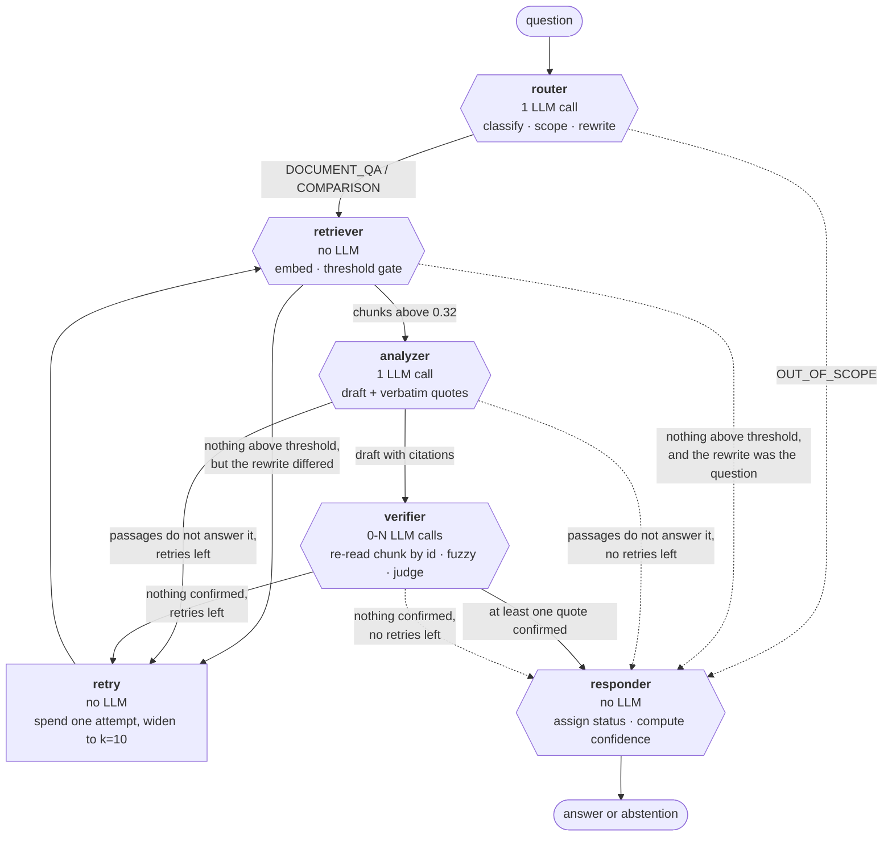

# PolicyLens

[](https://github.com/Edgezone-commits/policylens/actions/workflows/ci.yml)

[](LICENSE)

An agentic RAG system that reads policy and contract documents, retrieves the
relevant clauses, and answers questions with cited sources — where every quote
is checked against the passage it claims to come from before the answer is
published.

---

## Demo

<!-- Drop a screen recording at docs/demo.gif and uncomment the next line.
     docs/demo-script.md is a 60-second script timed for exactly this. -->
<!--  -->

**A recording belongs here.** Record the 60 seconds in
[docs/demo-script.md](docs/demo-script.md), save it as `docs/demo.gif`, and
uncomment the image line above.

**Hosted demo:** not deployed yet. [docs/deploy.md](docs/deploy.md) is the
click-by-click for a free Hugging Face Space, and the image it deploys is
built on every push by CI.

The one thing to try, in any version of the demo: ask **"how much is the
minimum monthly wage in rupees?"** The indexed Act says the Government fixes
the minimum wage and never states an amount, so the only honest answer is that
the documents do not contain one. A conventional pipeline returns five
plausible paragraphs of labour law and a confident figure.

---

## What it does

- **Answers questions from a document corpus with verbatim citations**, each
  carrying its source document, page, and a verdict on whether the quote was
  confirmed.
- **Verifies every quote against the source, by id** — never against what the
  model echoed back. The citation names a `chunk_id`; the verifier re-reads
  that chunk from the vector store and compares. An invented `chunk_id` fails
  as `unknown_chunk`. Measured: 54 of 54 quotes verified.
- **Refuses what the documents do not support.** Three independent gates — a
  calibrated relevance threshold, the analyzer's own reading of the passages,
  and verification — can each end in `INSUFFICIENT_EVIDENCE`. Measured: 14 of
  15 unanswerable questions refused, with 0 of 38 answerable ones wrongly
  refused.
- **Exposes its own reasoning path** as a field in the API response, one entry
  per node, rather than as something to reconstruct from logs.
- **Runs the whole test suite with no API key and no network** — 193 tests in
  about 25 seconds, against a scripted LLM and a fake embedder.

---

## Architecture



Solid edges carry evidence forward. The dashed edges are the abstention paths,
and there are four of them. One edge in the whole graph reaches the responder
carrying an answer — that asymmetry is the design.

| Node | What it does | Why it exists |
|---|---|---|
| **Router** | Classifies the question, optionally scopes it to one document, and rewrites it into the corpus's vocabulary. 1 LLM call. | An out-of-scope question should cost one call, not five. The rewrite matters because embeddings match wording, not intent — "can my boss keep me on trial?" is a poor neighbour of "probation period". It deliberately does **not** judge whether an answer exists; it has read no evidence. |
| **Retriever** | Embeds the query and returns chunks above the calibrated threshold, or nothing. No LLM. | The only place that decides whether evidence exists. Without its gate a vector search always "succeeds" and returns the five least-unrelated paragraphs. For a comparison it retrieves per document, because a pooled top-5 over a 234-chunk Act and a 32-chunk summary fills from the Act. |
| **Analyzer** | Drafts the answer with a verbatim quote behind every claim, or declines. 1 LLM call. | Its real work is refusing to trust the reply: every citation is resolved back to a real chunk before the verifier sees it, and anything unresolvable is dropped with a reason recorded. It may abstain with passages in hand — retrieved is not relevant. |
| **Verifier** | Re-reads each cited chunk **by id**, fuzzy-matches, and escalates to an LLM judge only when string matching cannot settle it. | The node the project exists for. A failed check is reported, never repaired — a reader who sees "this quote was not found" is better served than one shown a tidied answer. |
| **Responder** | Assigns the final status and computes confidence. No LLM. | One exit for every path, so an abstention reads the same way every time. Keeps "I found no evidence" and "I could not run" as different claims. |
| **Retry** | Spends one attempt, widens `k` from 5 to 10, and re-runs the user's original wording alongside the rewrite. Max 2. | A node rather than an edge, because LangGraph's conditional edges choose a route and cannot write state — and the counter must increment exactly once per loop or the loop never terminates. |

Full detail in [docs/ARCHITECTURE.md](docs/ARCHITECTURE.md), which also has a
sequence diagram of the whole request lifecycle from the UI to a rendered
citation. The reasoning behind each technology choice is in
[docs/DECISIONS.md](docs/DECISIONS.md).

### The five statuses

| Status | Meaning | HTTP |
|---|---|---|
| `ANSWERED` | Answered; every citation verified | 200 |
| `PARTIALLY_VERIFIED` | Answered, but a citation could not be confirmed. Shown and labelled, not hidden | 200 |
| `INSUFFICIENT_EVIDENCE` | The documents do not support an answer. **A correct outcome** | 200 |
| `OUT_OF_SCOPE` | Not a question about these documents | 200 |
| `ERROR` | The pipeline itself failed | 503 |

**An abstention is a 200.** A 4xx would tell every client the request was
malformed; a 5xx would make this project's most important behaviour read as an
outage in every log and dashboard, which teaches whoever watches it that
honesty is a malfunction. Only a pipeline failure is 5xx, and there is a test
whose only job is to hold that line.

---

## Why LangGraph, not a plain chain

The retry is a genuine cycle: it is entered from three different nodes, it
carries a counter that must increment exactly once per iteration or it never
terminates, and it has three exit conditions. A sequential chain can only
express that as a hand-rolled `while` loop around the whole pipeline, which is
where the state bookkeeping stops being inspectable. The second reason is the
trace: every node appends to `state["trace"]`, so "how did this answer happen"
is a field in the response rather than a logging exercise.

---

## Results

Two sets of numbers, measured differently, kept apart on purpose.

**End-to-end** figures come from a 53-question labelled run on 2026-10-06
against 279 chunks from 3 documents, recorded in `evaluation/results/`
(timestamped files gitignored; regenerate with `python scripts/evaluate.py`).
**Retrieval and latency** figures are regenerated for free by
`make eval` and committed as
[`evaluation/results/retrieval.md`](evaluation/results/retrieval.md) and
[`evaluation/results/perf.md`](evaluation/results/perf.md), so the working
behind the tables below can be opened.

### The two error types, never averaged

| Metric | Result | |
|---|---|---|
| **False answer rate** | **6.7%** | 1 of 15 unanswerable questions got an answer |
| **False abstention rate** | **0%** | 0 of 38 answerable questions were refused |

They are reported separately because they do not cost the same. A false
abstention denies the user an answer, and they can see it happen. A false
answer looks exactly like a correct one. A single "accuracy" figure would let
an improvement in the cheap error hide a regression in the expensive one, so
`scripts/evaluate.py` exits non-zero on a false answer alone.

### Correctness and grounding

| Metric | Result | Basis |
|---|---|---|
| Answer accuracy | **86.8%** | 33 of 38 answerable |
| Citation verification | **100%** | 54 of 54 quotes confirmed against the cited passage |
| Citation recall | 78.9% | cited every document the answer needed |
| Overall correct | 88.7% | 47 of 53, whichever decision was the right one |
| Confidence separation | **0.011** | 0.850 mean when right, 0.839 when wrong |

### Retrieval, measured alone — no LLM

38 answerable questions against the 279-chunk index, searched to depth 10.

| k | Hit rate@k | Recall@k | Recall@k, cross-document |
|---|---|---|---|
| 1 | 86.8% | 60.5% | 0.0% |
| 3 | 100.0% | 92.1% | 70.0% |
| 5 | 100.0% | 92.1% | 70.0% |
| 10 | 100.0% | 97.4% | 90.0% |

**MRR 0.925** overall — 0.899 single-document, 1.000 cross-document.

Hit rate@k asks whether *at least one* needed document appeared; recall@k
asks whether *all* of them did. The gap between the two columns is this
project's clearest measured weakness, and the shape of it is diagnostic:
cross-document questions reach one needed document at rank 1 every single
time (hit rate@1 = 100%, MRR = 1.000) and both documents never (recall@1 =
0%). The missing evidence is not unreachable — it sits at ranks 6 to 10, which
is why recall@10 recovers to 90%. The Act is 234 of 279 chunks against the
Rules summary's 32, so it dominates a global top-5 by sheer mass. That puts a
measured ceiling on the planned fix (retrieve per document and merge, rather
than taking one global top-5): roughly **70% to 90%**.

Two caveats that keep these honest, and they are in the script's own
docstring: ground truth here is **document-level**, not gold chunk ids, so
"rank 1" only means the top chunk came from a needed document — generous by
construction. And the search uses the question **as asked**, while the live
system searches the router's rewrite, so these are a floor rather than a
measurement.

### Latency and cost

53 questions, derived from the recorded runs.

| | p50 | p95 | mean | max |
|---|---|---|---|---|
| Latency (s) | **9.06** | **18.42** | 10.37 | 25.22 |
| LLM calls | 2.00 | 4.00 | 2.11 | 4.00 |
| Tokens per question | 2,251 | 7,653 | 2,685 | 8,368 |

142,304 tokens for all 53 questions. **Cost per query is zero**: the Gemini
free tier and local embeddings mean no request in this project has ever been
billed, which is also the constraint that shaped it (see Limitations). Most
of that latency is a deliberate 4-second throttle between LLM calls
(`config.LLM_MIN_SECONDS_BETWEEN_CALLS`) to stay inside free-tier per-minute
limits — it is a configuration value, not a property of the system.

### Verification on versus off

| | ON | OFF |
|---|---|---|
| False answer rate | 6.7% | **6.7%** |
| Correct | 14 / 15 | **14 / 15** |
| Statuses changed | — | **0** |

Run with `--no-verify` over the 15 unanswerable questions. **Nothing
changed.** Discussed under Limitations, because it concerns the centrepiece.

---

## Quickstart

Verified on Python 3.12.10. The whole test suite runs without an API key; only
asking a real question needs one.

```bash
git clone https://github.com/Edgezone-commits/policylens.git
cd policylens

make install            # creates .venv and installs the pinned dependencies
make test               # 193 tests, no API key needed, ~25s
```

To ask a question you need a free Gemini key from
https://aistudio.google.com/apikey — no card required.

```bash
cp .env.example .env            # then put a real GOOGLE_API_KEY in it
make check-models               # which models your key can reach right now
python scripts/download_sample_docs.py   # fetches the sample corpus
make ingest                     # PDFs -> chunks -> ChromaDB

make run                        # API on :8000, UI on :8501
```

**Two Windows notes**, both found by running the quickstart from a fresh
clone on a Windows 11 machine:

- `make` is not installed by default. Every target is a one-line command —
  open the [Makefile](Makefile) and run the line directly, or install make
  with `winget install ezwinports.make` and use Git Bash.
- **If `pip install` fails with `OSError: [Errno 2] No such file or
  directory` on a long `torch/include/ATen/...` path**, that is Windows'
  260-character path limit, not a broken requirement. `torch` ships headers
  with very deep paths. Either enable long paths (`Set-ItemProperty
  'HKLM:\SYSTEM\CurrentControlSet\Control\FileSystem' LongPathsEnabled 1`
  as administrator, then reboot) or clone somewhere short such as
  `C:\policylens`. The install succeeds from a short path with long paths
  still disabled.

Ask one question without starting a server:

```bash
python scripts/ask.py "What is the maximum probation period for a worker?" --trace
```

### Docker

```bash
cp .env.example .env            # put a real GOOGLE_API_KEY in it
make docker                     # API on :8000, UI on :8501
make docker-ingest              # build the index inside the container
```

> Built and verified in CI rather than locally — the development machine is
> Windows 11 Home without WSL, so Docker Desktop's Linux engine could not
> start. CI builds both images on every push, asserts they run as a non-root
> user, and checks the embedding model was baked in so the container answers
> offline.

### The API

```bash
curl -s -X POST http://127.0.0.1:8000/ask \
  -H 'Content-Type: application/json' \
  -d '{"question": "What is the maximum probation period for a worker?"}'
```

```json
{
  "question": "What is the maximum probation period for a worker?",
  "status": "ANSWERED",
  "answer": "According to the Nepal Labour Act, 2074, an employer may enter into an employment contract with a worker such that they remain in a probation period for a maximum of six months.",
  "citations": [
    {
      "chunk_id": "Nepal_Labour_Act_2074.pdf::p7::c12",
      "quote": "In entering into an employment contract with a labour, the employer may so enter into the contract that he or she remains in a probation period for six months",
      "source_document": "Nepal_Labour_Act_2074.pdf",
      "page_number": 7,
      "section": "Section 13",
      "verified": true,
      "method": "exact",
      "match_score": 100.0
    }
  ],
  "confidence": 0.803,
  "top_similarity": 0.5063,
  "verified_count": 1,
  "unverified_count": 0,
  "latency_seconds": 14.8
}
```

| Method | Path | Does |
|---|---|---|
| `POST` | `/ask` | Answer a question |
| `GET` | `/documents` | List indexed documents |
| `POST` | `/documents` | Upload and index a PDF or .txt |
| `DELETE` | `/documents/{name}` | Remove a document |
| `GET` | `/health` | Index size, key presence, model chain, threshold |
| `GET` | `/queries` | Recent questions and answers |
| `GET` | `/stats` | Aggregates, including the abstention rate |

Interactive docs at `/docs`.

---

## Project structure

```
src/
  ingestion/     loading, cleaning, chunking, indexing
  retrieval/     embeddings and the ChromaDB store that holds the relevance gate
  agent/         the graph, its five nodes, the single LLM call site, the prompts
  api/           FastAPI app and the response schemas that are the public contract
  db/            SQLite query log
  config.py      every tunable value, each with the reason it has that value
frontend/        Streamlit UI, which reaches the agent over HTTP only
evaluation/      the 53-question labelled dataset, the grader, the metrics
  results/       retrieval.md and perf.md, regenerated for free and committed
scripts/         ingest, ask, calibrate, check models, evaluate, eval_retrieval, eval_perf
tests/           193 tests, none needing an API key
deploy/
  huggingface/   Space Dockerfile and entrypoint, built on every push by CI
docs/            architecture, decisions, evaluation, deploy, demo script
```

---

## Evaluation

Everything in the Results tables can be regenerated. Two of the three cost
nothing:

```bash
make eval                 # retrieval metrics and latency percentiles -- no LLM
python scripts/eval_retrieval.py --ks 1 3 5 10 20
python scripts/eval_perf.py --include-unverified
```

`eval_retrieval.py` searches the live index; `eval_perf.py` derives
percentiles from runs already on disk, so neither spends a single call. Both
write a JSON file and a markdown summary to `evaluation/results/`.

The end-to-end run does cost quota — 2 to 5 LLM calls per question:

```bash
python scripts/evaluate.py                 # all 53 questions
python scripts/evaluate.py --limit 6       # stay inside a daily quota
python scripts/evaluate.py --only cross    # cross-document only
python scripts/evaluate.py --no-verify     # the control arm
python scripts/evaluate.py --recall-only   # Recall@5 only, free
```

A local index drifts as documents are uploaded through `POST /documents`, and
retrieval numbers are only comparable across runs if the corpus is the same.
`--index` points `eval_retrieval.py` at a specific Chroma directory for that
reason; the committed table was measured against an index rebuilt from the
three documents the 2026-10-06 run used.

Methodology, the full failure analysis and the adjudication of every wrong
answer are in [docs/EVALUATION.md](docs/EVALUATION.md).

---

## Known limitations and next work

**The confidence score does not work, and is reported as a failure.** Mean
confidence is 0.850 on correct answers and 0.839 on wrong ones — a separation
of 0.011. The mechanism is plain: `verified_fraction` is 1.0 on 54 of 54
quotes, so the 0.6 term is a constant, and `top_similarity` spans only
0.50–0.72, so the 0.4 term moves by 0.09 in total. The formula is dominated by
a term that never varies. **Confidence built from verification cannot
discriminate in a system where verification almost always passes.** A fix
needs a signal that tracks *relevance* rather than *groundedness* — the margin
between the best and second-best chunk, or agreement across the retrieved set.
The weights are in `config.py` so they can be re-fitted.

**The verification loop — the centrepiece — is unproven at scale.** Zero of 15
outcomes changed with it switched off. The reason is structural rather than
flattering: it is the third of three gates, the router caught 8 of those
questions and the threshold plus the analyzer caught 6, so only one question
produced a citation at all, and that quote was genuine. Its value is shown by
a unit test (the same fabricated quote is withdrawn with verification and
published without it), not by this measurement. The defensible claim is
narrow: it costs almost nothing, because verbatim quotes settle by string
matching and the judge is rarely called, and it has never produced a false
negative — 54 of 54 genuine quotes passed. Measuring it properly needs a
dataset that induces plausible-but-unsupported *quotes*, which is harder to
write than an unanswerable question. **That dataset is the single highest-value
piece of next work.**

**Perfect grounding is not correctness.** All 54 quotes verified, and 13% of
answers still missed the decisive fact. The clearest case: asked which leaves
are claimable as of right, the system quoted Section 51 verbatim and asserted
the opposite of it. Every check passed. Verification prevents fabrication, not
irrelevance.

**Cross-document answers usually cite one document, not both** — 20% cited
both, and accuracy there is 70% against 100% single-document recall. Quantified
above: the evidence is reachable at ranks 6–10, so retrieving per document and
merging should take cross-document recall from 70% to about 90%.

**Retrieval ground truth is document-level.** Hit rate, recall and MRR are
computed over document names rather than gold chunk ids, which makes them
generous — the Act is 84% of the index by chunk count. Chunk-level labels are
a labelling job and would make the ranking numbers mean what they appear to.

**The evaluation is small and single-run.** 53 questions, so one question is
about 2 percentage points. Temperature 0.0 makes it deterministic, but there
are no repeated runs and therefore no variance estimate. The grader checks
that the decisive fact is present, not that everything around it is right.

**One false answer is arguably the grader's.** Asked the overtime rate for a
public holiday, the system gave the one adjacent provision that exists and
then said the documents do not specify a rate. It hallucinated nothing, but
the grader classifies by status alone and cannot tell that from an invented
figure. By this dataset's own labelling rule the question is mislabelled. It
was left in and 6.7% reported anyway, because editing a dataset after seeing
the result makes every number in it suspect. Adjudicated in
[docs/EVALUATION.md](docs/EVALUATION.md).

**The free tier is the binding constraint.** About 20 requests per model per
day, charged per *model* rather than per key, and one answer is 2–5 calls.
`config.LLM_FALLBACK_MODELS` chains sibling models because each name has its
own bucket, which is what makes a 53-question run affordable at all. Run
`scripts/check_models.py` before planning a batch.

**Section labels are best-effort.** The chunk whose text begins "13. Provision
relating to probation period" carries the metadata "Section 12". Document and
page are reliable; the section locator drifts by one, and the evaluation does
not grade on it.

**Text-layer PDFs only.** A scanned PDF extracts nothing and is reported as
skipped rather than indexed as empty. No OCR.

**Two documents and a licence is a small corpus.** Nothing has been tested at
a scale where the router's document-selection step would itself have to become
retrieval.

---

## Tech stack

**Agent and LLM**
- [LangGraph](https://langchain-ai.github.io/langgraph/) — the retry is a real
  cycle with a counter and three exit conditions
- [LiteLLM](https://docs.litellm.ai/) — makes the provider a config string, so
  the fallback chain costs nothing to express
- Google Gemini on the free tier, with a chain of sibling models as fallback
- [LangChain](https://python.langchain.com/) — used only for document loading
  and recursive splitting, the parts that are plumbing rather than
  orchestration

**Retrieval**
- [ChromaDB](https://docs.trychroma.com/) — persistent on disk, metadata
  filtering instead of a collection per document, and lookup by id, which is
  exactly how the verifier re-reads a cited chunk
- [Sentence Transformers](https://www.sbert.net/) `all-MiniLM-L6-v2` — local,
  free, offline, 384 dimensions
- [RapidFuzz](https://rapidfuzz.github.io/RapidFuzz/) — settles most citation
  checks in microseconds, so the LLM judge is rarely called

**API and UI**
- [FastAPI](https://fastapi.tiangolo.com/) — the response model *is* the public
  contract, and dependency injection is what lets 27 API tests run against a
  fake agent
- [Streamlit](https://streamlit.io/) — a reader for one person, talking HTTP
  only
- SQLite — every question worth asking of the query log is an aggregate, which
  is one SQL statement each

**Evaluation and infrastructure**
- pytest — 193 tests, no API key, about 25 seconds
- ruff and black, with pre-commit, enforced by a CI job
- Docker and docker-compose; a second image for the Hugging Face Space, built
  on every push so it cannot drift
- GitHub Actions — lint, tests with no secrets, and both image builds

---

## License and contact

MIT — see [LICENSE](LICENSE).

**Edgezone-commits**
GitHub: [@Edgezone-commits](https://github.com/Edgezone-commits) ·
Email: kesrwag057@gmail.com

<!-- Add your LinkedIn here, e.g.
     LinkedIn: [your name](https://www.linkedin.com/in/your-handle/)
     It was left out rather than guessed: a dead link in a README is worse
     than a missing one. -->

### Corpus and references

- Nepal Labour Act, 2074 (2017) and Nepal Labour Rules, 2075 (summary) — the
  corpus
- Apache License 2.0 — a deliberately unrelated third document, so a
  cross-document question has something to be wrong about
- Gemini API rate limits — https://ai.google.dev/gemini-api/docs/rate-limits
