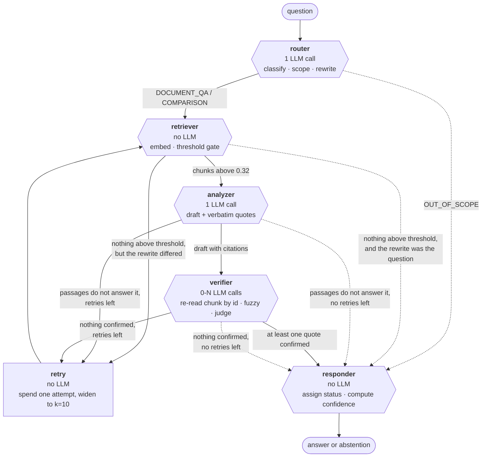
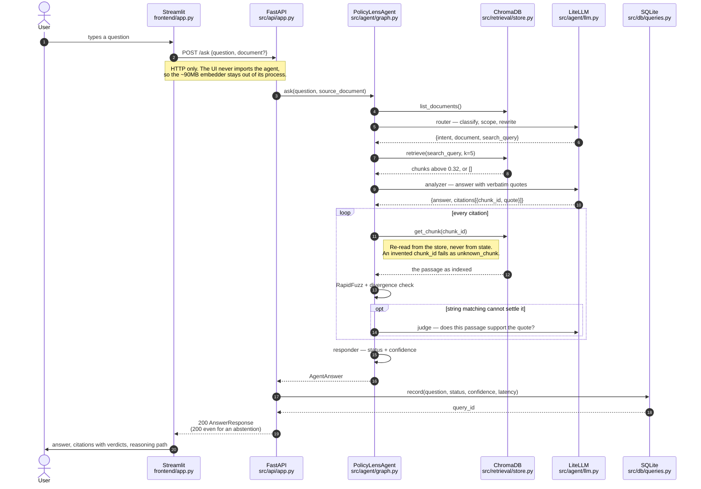

# Architecture

How a question becomes a cited answer, node by node, and what each node is
defending against. The reasoning behind the technology choices is in
[DECISIONS.md](DECISIONS.md); the measured behaviour is in
[EVALUATION.md](EVALUATION.md).

---

## The shape of it



Solid edges carry evidence forward. **Dashed edges are the abstention paths**,
and there are four of them: out of scope, nothing retrieved, nothing relevant,
nothing verified. One edge in the whole graph reaches `responder` carrying an
answer. That asymmetry is the design: it is easy to arrive at "I will not
answer this" and hard to arrive at "here is the answer".

The hexagons are the nodes that make a decision; `retry` is a plain box
because it decides nothing — it exists only to increment the counter, which a
LangGraph conditional edge cannot do (edges choose a route, they cannot write
state). The counter must increment exactly once per loop or the loop never
terminates.

Built by `build_graph()` in `src/agent/graph.py`, which also takes
`verify=False` for the evaluation's control arm. That build omits the
`verifier` node entirely and routes `analyzer` straight to `responder`, which
is why the analyzer's outgoing edge is produced by a factory
(`make_after_analyzer`) rather than written once — LangGraph reads the return
annotation to infer reachable nodes, and `"verifier"` is not reachable in a
graph that has no verifier.

State is a `TypedDict` (`src/agent/state.py`) that every node reads and
partially updates. LangGraph merges each node's returned dict into it, which
is why nodes return `{"status": ...}` rather than mutating.

---

## Node by node

### 1. Router — `src/agent/nodes/router.py`

| | |
|---|---|
| **In** | `question`, plus the list of indexed document names |
| **Out** | `intent`, `source_document` (optional), `search_query`, `router_reason` |
| **LLM** | 1 call, `simple_task=True` (thinking disabled) |

Classifies the question as `DOCUMENT_QA` or `OUT_OF_SCOPE`, optionally picks a
single document, and **rewrites the question into a search query**.

**Why classify at all**, when the relevance threshold would also reject an
off-topic question: cost and honesty. "What is the capital of Brazil?" should
cost one call, not five, and `OUT_OF_SCOPE` is a more precise thing to tell a
user than `INSUFFICIENT_EVIDENCE` — the first says "wrong system", the second
says "right system, nothing in these documents". Measured: all 10
out-of-domain questions exit here in 1 call, mean 5s.

**Why rewrite the query.** The embedding model matches *wording*, not intent.
"How long can they keep me on probation?" and the Act's "remains in a
probation period for six months" share little surface form. The rewrite is
what gets embedded, not the raw question. This has a measurable effect: one
question in the evaluation misses on Recall@5 measured against the raw
question and was answered correctly end to end, because the rewrite reached a
chunk the raw wording could not.

**Why thinking is disabled here.** It is classification, not reasoning.
Thinking roughly doubles latency and token cost for no measured gain.

### 2. Retriever — `src/agent/nodes/retriever.py` → `src/retrieval/store.py`

| | |
|---|---|
| **In** | `search_query`, `source_document`, `retry_count` |
| **Out** | `chunks`, `top_similarity` |
| **LLM** | none — local embeddings |

**The only place in the system that decides whether evidence exists.** That
makes it the foundation of every abstention.

The threshold (0.32, calibrated — see DECISIONS) is applied twice:

1. **As a gate.** If even the best chunk scores below it, return an empty list
   rather than the best of a bad set. Without this, vector search *always*
   succeeds: ask about chocolate cake and it hands back the five
   least-unrelated paragraphs of labour law, which the model will then answer
   from, with citations. Measured on this corpus: off-topic questions peak
   around 0.18, answerable ones score 0.52–0.71.
2. **As a filter** on what remains. A set like `[0.70, 0.68, 0.31, 0.29]` is
   better truncated than passed whole — the weak chunks contribute no evidence
   but do give the model extra material to misattribute a citation to.

On retry, `top_k` widens from 5 to 10.

### 3. Analyzer — `src/agent/nodes/analyzer.py`

| | |
|---|---|
| **In** | `question`, `chunks` |
| **Out** | `answer`, `citations` (unverified), or `analyzer_abstained` |
| **LLM** | 1 call, thinking **on**, `max_tokens=4096` |

Reads the passages and either drafts an answer with verbatim quotes or says
the passages do not answer the question.

**Why it can abstain even with passages in hand.** Retrieved is not relevant.
A chunk can clear 0.5 similarity by sharing vocabulary while saying nothing
about the question. This is the second of the three gates.

**Why its token budget is its own** (`LLM_MAX_TOKENS_FOR_CITED_ANSWER`,
4096, against the global 1024): its reply carries a verbatim quote per
citation, not just prose. The gratuity question spans Rule 23, Section 52 and
Section 53 — six quotes, ~8.5k tokens with thinking. At 1024 the reply is cut
off mid-string, which downstream looks like the model returning garbage rather
than a budget that was too small.

**Why thinking stays on.** This is the one step that has to read five
excerpts, reconcile them and compose a cited answer.

Citations leave here marked `verified=False, method="unchecked"`. Nothing
claims to be verified before it has been.

### 4. Verifier — `src/agent/nodes/verifier.py`

| | |
|---|---|
| **In** | `citations` (unverified) |
| **Out** | `citations` (with verdicts), `verified_count`, `unverified_count`, `verified_ratio` |
| **LLM** | 0–N calls, only for quotes string matching cannot settle |

**The heart of the system.** For each citation:

1. Look the chunk up **by `chunk_id`** in the vector store — re-reading the
   source, never trusting the text the analyzer echoed back. If the analyzer
   invented a `chunk_id`, the lookup returns nothing and the citation fails as
   `unknown_chunk`.
2. Reject quotes shorter than `MIN_CITATION_QUOTE_CHARS` (40) outright. The
   fuzzy check is a *partial* match, and three or four words score 100 against
   almost any legal prose — "the employer shall" would be stamped verified
   while supporting nothing.
3. RapidFuzz partial match. A high score alone is **not** accepted (below).
4. Escalate to an LLM judge only when string matching cannot settle it.

**Why a fuzzy ratio alone is unsafe**, which a test caught: swapping "six
months" for "one year" in a 30-word clause still scores in the nineties, and
deleting one "not" costs about three points. Both passed as verified while
asserting the opposite of the source. `citation_divergences()` now aligns the
quote to the span it claims to reproduce and requires quantities and negations
to match **in both directions**.

**Failures are reported, never repaired.** An answer whose quotes do not check
out is withdrawn; a partially verified one is published with the failing
citation marked and a note saying why. Silently dropping a bad citation would
leave a confident answer with no sign that part of it was unsupported.

### 5. Responder — `src/agent/nodes/responder.py`

| | |
|---|---|
| **In** | everything |
| **Out** | `status`, `answer`, `confidence` |
| **LLM** | none |

Assigns the final status and computes confidence. Takes no dependencies — it
only reads state, which is why it needs no mocking to test.

It keeps two things apart that look identical in the state:

- **`ERROR` vs `INSUFFICIENT_EVIDENCE`.** "I could not run" and "I found no
  evidence" are different claims. Conflating them would let a dead API key
  read as a documented absence of evidence.
- **"nothing could be confirmed" vs "nothing was checked."** Both are
  `verified_count == 0`. The first withdraws the answer; the second is the
  evaluation's control arm (`verify=False`) and publishes it, labelled.

Unverified citations are **not** carried into an abstention: the answer they
supported has been withdrawn, so showing them would be offering evidence for
a claim no longer made.

**Confidence** is computed, never asked of the model:

```
0.6 × verified fraction + 0.4 × top similarity − 0.10 × retries
```

Self-reported confidence clusters near 0.9 whether the answer is right or
wrong. This formula is built from facts the system measured — but see
EVALUATION: measured separation between right and wrong answers is **0.011**,
so it does not currently discriminate either.

### The retry loop — `retry_node` in `src/agent/graph.py`

Entered from the retriever (nothing above threshold), the analyzer (passages
don't answer it) or the verifier (nothing verified). Max 2.

**Why a node rather than a flag set on an edge:** LangGraph's conditional
edges choose a route, they cannot write state, and the counter has to be
incremented exactly once per loop or the loop will not terminate.

**Why retry at all, when retrieval is deterministic:** the retry does not
repeat the same search. It widens `top_k` from 5 to 10 and, if the router's
rewrite was the problem, falls back to the question as asked.

It **clears** `citations`, `answer` and `analyzer_abstained`. Without that, a
second pass that abstains would leave the first pass's unverified citations
sitting in state when the responder read it.

---

## The request lifecycle

The graph above is the middle of a longer path. One question from the UI to a
rendered citation:



Three things in that sequence are load-bearing:

**The UI speaks HTTP and nothing else.** It could be replaced by curl without
the agent noticing, which is what makes the response schema
(`src/api/schemas.py`) a real contract rather than a convenience — anything
the UI can display, another client can obtain.

**The verification loop re-reads from the store.** The arrow goes back to
ChromaDB, not to the agent's own state. Checking a quote against the copy the
analyzer handled would verify the analyzer against itself.

**The log write happens after the answer, and its failure cannot lose the
answer.** `query_id` comes back as a field in the response; if SQLite is
unavailable the answer is still returned, with `query_id` null.

---


## Around the graph

### The single LLM call site — `src/agent/llm.py`

Every model call in the system goes through `LLMClient`, which owns:

- **A throttle**, shared process-wide via one class-level clock. Free tiers
  limit per minute as well as per day, so calls must be spaced — and a
  throttle only works if it cannot be bypassed, which means one door.
- **A fallback chain.** The daily quota is charged per *model*, so sibling
  models multiply what one key can do. A per-*day* refusal (`retryDelay`
  ~18 hours) marks the model spent for the run instead of backing off against
  it; a per-*minute* 429 is still retried. That distinction cut one measured
  question from 88.5s to 14.8s.
- **Provider-quirk memoisation.** A model that rejects `response_format` or
  `reasoning_effort` is remembered, so one `BadRequest` does not recur on
  every prompt.
- **Truncation handling.** A reply cut off by the budget is not a formatting
  mistake, so it gets a bigger budget rather than a sterner prompt — scolding
  the model about JSON made it return a shorter answer that abandoned the
  question.

### Ingestion — `src/ingestion/`

`loader.py` extracts per-page `Document`s, cleans whitespace, and strips
running headers by **frequency** (a line on ≥50% of ≥4 pages). Frequency not
position, because extraction column order varies; ≥4 pages because on two
pages any shared line clears 50% and real content would be stripped.

`chunker.py` splits to 1000/200 and attaches what every citation needs:
`source_document`, `page_number`, `chunk_index`, `chunk_id`, `section`.
Chunk ids are **deterministic**, so re-ingesting overwrites rather than
silently doubling the index. Fragments under `MIN_CHUNK_CHARS` are dropped.

A chunk records both the section it *starts* in and every section whose
heading falls *inside* it — a 1000-character chunk routinely straddles a
boundary, and the chunk holding the probation answer begins inside Section 12
while containing the whole of Section 13.

### API — `src/api/app.py`

A thin shell owning three things the agent should not: when the expensive
objects are built (once, at startup — the embedding model is ~90MB), how an
upload becomes an indexed document, and the status codes.

`create_app(agent, query_log)` takes both dependencies, which is what lets 27
tests run every endpoint against a fake agent and a temp database — no model,
no key, no network.

**An abstention is 200.** Only `ERROR` is 5xx.

### Query log — `src/db/queries.py`

One wide SQLite table, WAL mode so the UI can read while the API writes.
Writes are best-effort: the caller has already paid several LLM calls for a
verified answer, and losing it to a locked database would be absurd.

### Frontend — `frontend/app.py`

Reaches the agent **only over HTTP**, never importing it. That keeps the API
the single contract and the embedding model in one process.

Two rules drive the layout: an abstention is rendered as a result with its own
panel and explanation, never a red error box; and a citation always shows its
verdict **in the expander header**, because a reader skimming three citations
needs to see which one to distrust without opening any.

---

## What the request path costs

Measured over 38 answerable questions: **2.0 LLM calls, 10.2s** per question.

| Path | Calls |
|---|---|
| Out of scope | 1 (router) |
| Nothing retrieved | 1 (router) |
| Answered, quotes match verbatim | 2 (router + analyzer) |
| Answered, a quote needs the judge | 3+ |
| One retry | +2 |

The verifier usually costs **nothing**: a verbatim quote is settled by string
matching, and the judge is only called when it cannot be.
